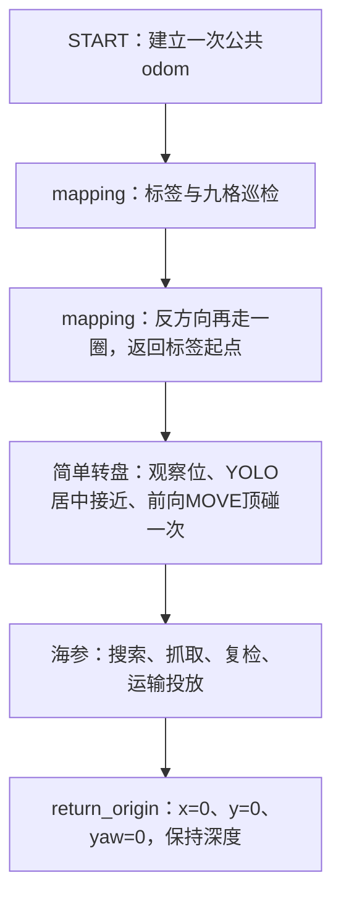

# 全流程联调任务树

配置：`src/uv_task/config/missions/full_flow_debug.yaml`。



普通阶段失败继续尝试后续阶段；START失败、外部停止停止后续移动。
建图定位断流时零推力、闪红灯等待恢复，不设置全局停止；等待仍计入任务总预算。
只有一个START；所有阶段的坐标必须相对同一个发车原点填写。
如果海参任务修改了odom平移，返回也使用修正后的任务odom；依赖校正正确，不能保证消除全部物理定位误差。

## conclusion 开关

本任务链的mapping参数已显式覆盖：

```yaml
enable_traversal: true
enable_conclusion: true       # false关闭结论接口，地图仍发布
require_complete_survey: true
```

修改本任务链的 `enable_conclusion` 后重启task_runner。
任务链覆盖值优先，单独修改 `tasks/mapping_grid.json` 不会改变本链已覆盖的开关。
开启后 `/task/mapping/conclusion` 以fallback配置输出；关闭时地图内嵌结论为null。
相机不可用但定位正常时，完整尝试九格和反向巡检；保留可靠视觉格点，只补缺失目标。
默认配置与视觉来源分别记录；单航点失败继续下一航点。
定位失效不能盲目继续。尝试航点和真正到达的航点分别记录，不以失败航点冒充完成。

## 连调参数位置

- mapping：`tasks/mapping_grid.json` 中九宫格/标签坐标、深度、fallback格点及标签ID。
- 简单转盘：`tasks/turntable_simple.yaml` 的 `disk_pose_odom` 填写盘心 `[x,y,z,yaw度]`；已导入昨日调试值 `[4.9,-2.4,0.85,-90]`；留空才会从mapping终点直接找框。预定位总预算180秒。
- 海参：`tasks/grab_sea_cucumber.yaml` 的搜索位、投放位、抓取/投放偏置和下压参数。
- 返回：链中 `return_origin.timeout=150秒`；只返回水平原点和START航向，保留当时深度。

当前任务使用的类别约定为mapping锥桶0/1、转盘3、海参2、收集框4。
共享 `robotcup20260901.yaml` 对这些ID的标签不同，实际加载权重必须核对；
本任务树不自动切换YOLO模型，不能仅凭任务名认定识别类别正确。

## 启动

camera、basic_motion和录制已启动后，在仓库根目录执行：

```bash
source /opt/ros/humble/setup.bash
source workspace_auv/install/setup.bash
ros2 launch uv_task task_launch.py target_id:=mapping_grid \
  mission_file:="$PWD/workspace_auv/src/uv_task/config/missions/full_flow_debug.yaml"
```

查看结论：`ros2 topic echo /task/mapping/conclusion --qos-durability transient_local`。
START跳过准备倒计时，启动任务链后立即执行START；修改配置后重启任务节点生效。

## 比赛任务链 competition.yaml

比赛入口是`src/uv_task/config/missions/competition.yaml`，不覆盖原联调链或仿真链。
顺序：START一次 → 前往标签/完整九宫格建图与当前反向格点巡检 → 简单转盘顶碰一次
→ 海参抓取最多360秒 → 保持深度返回odom(1,-1)并恢复靠岸航向
→ 可选定时机体+x开环前推 → 配置上浮推力则定时上浮，否则低速闭环上浮 → 全轴零推力。
普通任务失败后继续后续任务，START失败/外部停止则中断；失败不标记为成功。
海参360秒预算包含该阶段的搜索、抓取、投放和返回，不包含之前建图与之后返航。

发车前填写/核对：

- 建图JSON中的`tag_x/tag_y`、`survey_z`、`floor_z`、九宫格中心和朝向；相机允许标签16/18。
- 比赛链转盘`disk_pose_odom: [x,y,z,yaw度]`。当前空列表表示仅原地寻找，不能当成完整导航。
- 海参YAML中的搜索点、可直接释放的投放点、选用爪子以及开环参数，均使用同一次START坐标系。
- 比赛链最后`return_shore`的`yaw_deg`须正对岸，填写前推/上浮推力与秒数。
  未测量的推力默认0，不猜测动力参数；会尝试返回(1,-1)，跳过开环靠岸但不跳过上浮。
  未配置负上浮推力时使用`surface_z_m: 0.0`、`surface_speed_mps: 0.05`、
  `surface_timeout_s: 60.0`、`surface_tolerance_m: 0.05`，需核对START后的实际水面z。
  依据实测深度逐步减速，只向上运动；深度断流时零推力等待，停止/60秒超时清零。
  水平返航失败仍尝试上浮，但整个返航结果仍为失败，不冒充已经到岸。
  ACTUATOR推力是归一化输入，不是速度、PWM或牛顿；x正向前，z负值上浮。
  开环推力阶段没有航向闭环；速度上浮阶段有深度外环和MCU速度环，没有接岸或出水检测。
  导航失败不盲目开环靠岸；停止、异常、到时均发送零推力。

真机在`/home/nvidia/YouLong_AUV_Control_System/workspace_auv`内：

```bash
source /opt/ros/foxy/setup.bash
colcon build --packages-up-to uv_task --symlink-install
source install/setup.bash
```

先运行micro-ROS连接、`ros2 run uv_control basic_motion`及camera；不要启动任务前同时
用rqt发布解锁心跳，保持START初始化流程的控制权。camera启用AI、前/下视和mapping视觉，
简单转盘仅使用YOLO框，不要求开启精确转盘的SGBM视觉模块。
使用五类模型时，应在启动camera的终端设置
`export UV_MODEL_MAPPING_FILE="$PWD/src/uv_camera/weights/real_last.yaml"`，
模型类别须为square_cone、round_cone、trepang、wheel、platform。

参数核对并确认路径后启动比赛（会立即START并执行移动）：

```bash
ros2 run uv_task task_runner --ros-args \
  -p target_id:=mapping_grid \
  -p mission_file:="$PWD/src/uv_task/config/missions/competition.yaml"
```

海参超时或普通阶段失败后，任务列表仍尝试下一阶段；最后靠岸参数直接写在比赛链中，
不另建基础移动/推力配置文件。请勿将未填参数的模板当作已完成真机验收的任务链。

## 比赛降级处理与record

- 建图相机观测超过3秒未更新视为不可用；有效定位须在1秒内收到。
  相机故障不杀死任务，继续按配置九格与巡检路线导航；已有可靠视觉结果不清空，
  分类票数达到`min_observations`且比例达到`class_vote_ratio`的格点优先保留，只补缺失两方两圆。
  补齐点使用配置格点中心，不沿用弱观测坐标，地图标记`source: fallback`且不伪称验证通过。
  官方提交结论仍按当前约定使用config；现场必须正确填写默认图。
  首圈/巡检单点移动失败跳过该点继续下一点；总超时只结束本阶段。
  定位断流清零推力、红灯0.5秒亮/0.5秒灭，恢复后继续；不设置全局stopped。
  等待不会延长建图总预算，也不会阻止14分钟接管，人工停止仍立即生效。
- `/task/mapping/map`携带`submitted_config`完整参数快照、`config_fallback_mode`、
  `travel_failures`、`attempted_visit_order`、`attempted_traversal_order`。
  `visit_order/traversal_order`只记录到达的点。默认结果的`verified_complete`为false。
  先开启uv_record后，这些字段会写入会话`metadata/mapping.jsonl`；不启动record只有ROS消息，
  任务不会另起录制器或创建独立录像目录。
- 海参已上浮但水平回观察位失败：跳过抓后计数，仍尝试运往收集区、释放和返回搜索区。
  不增加确认抓获数量；未离底、定位缺失、停止、坐标校正结果未知时不盲目运输。
- 参数放宽仅用于未启用功能/冗余要求：关闭总计时不校验返航字段，空参数组沿用默认值，
  关闭收集框视觉不校验其参数，舵机抓放角度不要求数值排序，计数允许配置1帧。
  非有限运动值、舵机角度范围、推力方向、配置结构错误、停止与总超时仍保留。
- 简单转盘首次识别超时/接近中丢失目标，使用非空`disk_pose_odom`进行WTRAVEL和SET归向。
  该目标是直接盘心坐标，没有观察距离退让，属于接触操作，需现场确认机构和路径。
  不再要求视觉，不代表盘体180度转动已完成；未填盘心、导航失败、停止、总超时不盲动。
- 海参收集框缺目/不同步/多候选框，改用新鲜单目框；多框选最接近该目光心的可信框。
  两目都不可用才等待或走配置点兜底，旧帧/非有限框仍拒绝。
- 兜底移动失败、释放前偏置/稳定未到位仍发张爪指令；外部停止例外。
  总预算耗尽时允许发一次清空夹爪的释放指令，不继续导航。
  `delivery_commands`记录发出的释放指令，不等于实际有效投放数量；无法确认区域的释放
  可能不计分并造成海参掉落，应使用录制和现场验证，不能伪报成功投放。

## world航点与跨任务避障路线

WTRAVEL不是恒定航向平移：它先面向目标，再沿机体前向移动，有水平行程时不自动
恢复输入yaw。随后SET归向会形成一次额外转向。现在近点在XY到位容差内不再按
厘米级定位噪声求atan2转向；反馈也区分实际执行航向和请求的末端yaw。

建图JSON默认`travel_mode: fixed_yaw`、`max_world_step_m: 0.4`。
先在当前位置调整深度和`survey_yaw_deg`，再沿world线段分段SET，整个平移过程中
保持同一深度/航向。格点顺序沿用当前相邻蛇形路线，没有改动现场坐标。
这限制的是目标步长，不是速度或实际轨迹误差；物理运动仍依赖下位机控制器。

比赛链在四个阶段前加入`world_waypoints`，中间点直接写在同一任务链，不另建YAML。
`waypoints`的每行必须为START后的绝对`[x,y,z,yaw度]`，不是增量。
模式`fixed_yaw`每个折点先原地调深归向，再保持yaw线性平移；
模式`face_path`显式使用原WTRAVEL转向前进和末端SET，仅在需要艇头朝行进方向时选择。
同一通道的各航点使用相同yaw，可避免每个折点重新转向。

四段依次为：起点→标签观察位、标签→转盘观察位、转盘→海参搜索位、海参→(1,-1)。
2026-10-13：已删除路线末点与下一任务观察/出发位的强制一致性判定。
旧`end_at_next_task`键可以读取但不生效；不会因XY/Z/yaw差异或没有下一任务而拒绝路线。
路线按用户航点执行，下一任务仍可自行粗定位/视觉对准；后续定位段也需现场确认路径。
当前盘心[2.79,-2.2,0.85,-90]、相机[0.23,0,0.076]、观察距离0.50，
换算观察位为[2.79,-1.47,0.774,-90]；可参考此观察位安排路线，但不要求末点完全一致。

2026-10-13：保留现场禁用的起点→标签段；其他三段修正为双层航点列表。
用户确认中间点后的通道安全，保留中间点并追加下一任务终点：
标签→转盘经[2.7,-0.2,0.1,0]到[2.79,-1.47,0.774,-90]；
转盘→海参经[2.7,-0.2,0.1,0]到[4,-2,0.1,0]；
海参→返航经[3,-1,0.1,0]到[1,-1,0.1,0]。
这些是配置路线，不是程序测得的安全通道；任务目标改变后应复核后续移动路径。
2026-10-14：任务间路线失败后跳过其余中间点，直接尝试这段路线最后一个目标，
保留fixed_yaw/face_path模式，额外预算最多40秒（不超过该段原timeout）。
最终目标兜底也失败则记录本段失败、继续后续任务，不再设置全局stopped。
`require_nonempty: true`下空路线没有可用目标，只失败本段；非法坐标不猜测修复，
定位缺失/过期时仍不发送移动指令；人工停止和14分钟总计时接管禁止兜底。
直接目标兜底会绕过原中间点，不具备避障能力，现场应确认直达线路是否可通行。
请勿仅填目标点就认为实现了避障；要按现场道具位置及艇体宽度、定位误差留足净距，
在安全区原地转向/升沉。0.4m自动细分不会绕开直线上的障碍。

本次只覆盖任务间衔接及建图格点移动。海参任务内部搜索区↔收集区运输仍使用
现有WTRAVEL+SET，并没有因此获得自动绕障能力，后续应单独提供运输安全通道。

## 全任务14分钟硬截止与1分钟返航上浮（2026-10-13）

`competition.yaml`的`mission.runtime`配置总计时：`time_limit_s: 840`，
从任务列表开始执行计时（含START准备），独立墙钟线程每50ms检查，使用monotonic，
不受仿真时间、单任务超时、任务sleep或ROS timer调度影响。
普通任务链提前完成/失败停止则结束计时，不在以后自行启动返航。

到14分钟：所有普通任务停止；移动action、速度/推力、舵机出口被锁存拦截，
即使旧任务仍在sleep或finally清理，也不能覆盖强制返航。
先取消所有旧BasicMotion目标（包括迟到的目标接受响应），等待结果终止后再返航；
取消等待也占用返航一分钟预算，最晚从任务开始15分钟发送全六轴零ACTUATOR推力。
取消卡住、START未成功、定位断更、返航点未填时不盲目运动，直接零推力锁存。

返航终点是同一次START的`(0,0)`，不是原来的靠岸准备点`(1,-1)`。
只设置一个中间XY航点：`return_waypoint_xy: [3,-1]`沿用原比赛返航中间点，
从该点到START及沿途上浮的通道必须现场核对；其他任务链未填写此参数时默认`[]`，
14分钟时只能停推力，不会猜测路线。任务文件没有runtime时也默认14分钟上限。
中间点需写在mission.runtime，不是任务列表中的world_waypoints。

返航XY和上浮Z在同一条body VEL指令中同时执行（不并行开两个action争抢setpoint）。
当前`max_xy_speed_mps: 0.2`、`max_up_speed_mps: 0.05`，比例减速并保持接管时航向。
`surface_z_m: 0`是START后深度基准，需确认真实水面；只上浮不主动下沉。
先到中间点再到START，达到`xy_tolerance_m: 0.15`与`z_tolerance_m: 0.05`可提前结束；
未达到也在`return_timeout_s: 60`内结束。参数只能限制速度，实际推力仍由MCU速度环决定。

结束后以20Hz持续发布`control_key=0x12/type_mask=0`的六轴零推力，不是仍可能产生推力的零速度。
`/task/status`显示`forced_return_start_and_surface`及cancelling/returning/off阶段，日志中文。
人工`/task/stop`可以提前中止强制返航；截止锁存后不能通过/task/run或/task/exec重新发车，
新比赛必须重启task_runner。关闭节点会先取消动作并发零推力。
它不能替代MCU看门狗或实体急停；其他GUI/CLI的setpoint发布器仍须关闭，
AGX进程崩溃、DDS断链、实际触岸/出水不由本逻辑保证。
