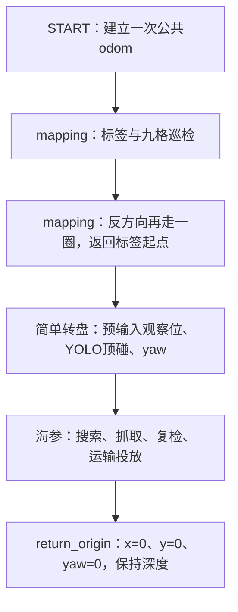

# 全流程联调任务树

配置：`src/uv_task/config/missions/full_flow_debug.yaml`。



普通阶段失败继续尝试后续阶段；START失败、外部停止和定位失效停止后续移动。
只有一个START；所有阶段的坐标必须相对同一个发车原点填写。
如果海参任务修改了odom平移，返回也使用修正后的任务odom；依赖校正正确，不能保证消除全部物理定位误差。

## conclusion 开关

本任务链的mapping参数已显式覆盖：

```yaml
enable_traversal: true
enable_conclusion: true       # false关闭结论接口，地图仍发布
require_complete_survey: true
```

修改本任务链的 `enable_conclusion` 后重启task_runner。
任务链覆盖值优先，单独修改 `tasks/mapping_grid.json` 不会改变本链已覆盖的开关。
开启后 `/task/mapping/conclusion` 以fallback配置输出；关闭时地图内嵌结论为null。
相机不可用但定位正常时，完整尝试九格和反向巡检，记录默认配置结果；单航点失败继续下一航点。
定位失效不能盲目继续。尝试航点和真正到达的航点分别记录，不以失败航点冒充完成。

## 连调参数位置

- mapping：`tasks/mapping_grid.json` 中九宫格/标签坐标、深度、fallback格点及标签ID。
- 简单转盘：`tasks/turntable_simple.yaml` 的 `disk_pose_odom` 填写盘心 `[x,y,z,yaw度]`；已导入昨日调试值 `[4.9,-2.4,0.85,-90]`；留空才会从mapping终点直接找框。预定位总预算180秒。
- 海参：`tasks/grab_sea_cucumber.yaml` 的搜索位、投放位、抓取/投放偏置和下压参数。
- 返回：链中 `return_origin.timeout=150秒`；只返回水平原点和START航向，保留当时深度。

当前任务使用的类别约定为mapping锥桶0/1、转盘3、海参2、收集框4。
共享 `robotcup20260901.yaml` 对这些ID的标签不同，实际加载权重必须核对；
本任务树不自动切换YOLO模型，不能仅凭任务名认定识别类别正确。

## 启动

camera、basic_motion和录制已启动后，在仓库根目录执行：

```bash
source /opt/ros/humble/setup.bash
source workspace_auv/install/setup.bash
ros2 launch uv_task task_launch.py target_id:=mapping_grid \
  mission_file:="$PWD/workspace_auv/src/uv_task/config/missions/full_flow_debug.yaml"
```

查看结论：`ros2 topic echo /task/mapping/conclusion --qos-durability transient_local`。
START跳过准备倒计时，启动任务链后立即执行START；修改配置后重启任务节点生效。

## 比赛任务链 competition.yaml

比赛入口是`src/uv_task/config/missions/competition.yaml`，不覆盖原联调链或仿真链。
顺序：START一次 → 前往标签/完整九宫格建图与当前反向格点巡检 → 简单转盘顶碰一次
→ 海参抓取最多360秒 → 保持深度返回odom(1,-1)并恢复靠岸航向
→ 定时机体+x开环前推 → 定时负z开环上浮 → 全轴零推力。
普通任务失败后继续后续任务，START失败/外部停止则中断；失败不标记为成功。
海参360秒预算包含该阶段的搜索、抓取、投放和返回，不包含之前建图与之后返航。

发车前填写/核对：

- 建图JSON中的`tag_x/tag_y`、`survey_z`、`floor_z`、九宫格中心和朝向；相机允许标签16/18。
- 比赛链转盘`disk_pose_odom: [x,y,z,yaw度]`。当前空列表表示仅原地寻找，不能当成完整导航。
- 海参YAML中的搜索点、可直接释放的投放点、选用爪子以及开环参数，均使用同一次START坐标系。
- 比赛链最后`return_shore`的`yaw_deg`须正对岸，填写前推/上浮推力与秒数。
  未测量的推力默认0，不猜测动力参数；会尝试返回(1,-1)，但跳过推力动作并报告未完成。
  ACTUATOR推力是归一化输入，不是速度、PWM或牛顿；x正向前，z负值上浮。
  该阶段没有航向闭环、接岸检测或出水检测，指令完成不代表实际靠岸成功。
  导航失败不盲目开环靠岸；停止、异常、到时均发送零推力。

真机在`/home/nvidia/YouLong_AUV_Control_System/workspace_auv`内：

```bash
source /opt/ros/foxy/setup.bash
colcon build --packages-up-to uv_task --symlink-install
source install/setup.bash
```

先运行micro-ROS连接、`ros2 run uv_control basic_motion`及camera；不要启动任务前同时
用rqt发布解锁心跳，保持START初始化流程的控制权。camera启用AI、前/下视和mapping视觉，
简单转盘仅使用YOLO框，不要求开启精确转盘的SGBM视觉模块。
使用五类模型时，应在启动camera的终端设置
`export UV_MODEL_MAPPING_FILE="$PWD/src/uv_camera/weights/real_last.yaml"`，
模型类别须为square_cone、round_cone、trepang、wheel、platform。

参数核对并确认路径后启动比赛（会立即START并执行移动）：

```bash
ros2 run uv_task task_runner --ros-args \
  -p target_id:=mapping_grid \
  -p mission_file:="$PWD/src/uv_task/config/missions/competition.yaml"
```

海参超时或普通阶段失败后，任务列表仍尝试下一阶段；最后靠岸参数直接写在比赛链中，
不另建基础移动/推力配置文件。请勿将未填参数的模板当作已完成真机验收的任务链。

## 比赛降级处理与record

- 建图相机观测超过3秒未更新视为不可用；有效定位须在1秒内收到。
  相机故障不杀死任务，继续按配置九格与巡检路线导航，提交默认config结果。
  首圈/巡检单点移动失败跳过该点继续下一点；总超时结束本阶段，定位失效/急停仍停止。
- `/task/mapping/map`携带`submitted_config`完整参数快照、`config_fallback_mode`、
  `travel_failures`、`attempted_visit_order`、`attempted_traversal_order`。
  `visit_order/traversal_order`只记录到达的点。默认结果的`verified_complete`为false。
  先开启uv_record后，这些字段会写入会话`metadata/mapping.jsonl`；不启动record只有ROS消息，
  任务不会另起录制器或创建独立录像目录。
- 简单转盘首次识别超时/接近中丢失目标，使用非空`disk_pose_odom`进行WTRAVEL和SET归向。
  该目标是直接盘心坐标，没有观察距离退让，属于接触操作，需现场确认机构和路径。
  不再要求视觉，不代表盘体180度转动已完成；未填盘心、导航失败、停止、总超时不盲动。
- 海参收集框缺目/不同步/多候选框，改用新鲜单目框；多框选最接近该目光心的可信框。
  两目都不可用才等待或走配置点兜底，旧帧/非有限框仍拒绝。
- 兜底移动失败、释放前偏置/稳定未到位仍发张爪指令；外部停止例外。
  总预算耗尽时允许发一次清空夹爪的释放指令，不继续导航。
  `delivery_commands`记录发出的释放指令，不等于实际有效投放数量；无法确认区域的释放
  可能不计分并造成海参掉落，应使用录制和现场验证，不能伪报成功投放。
