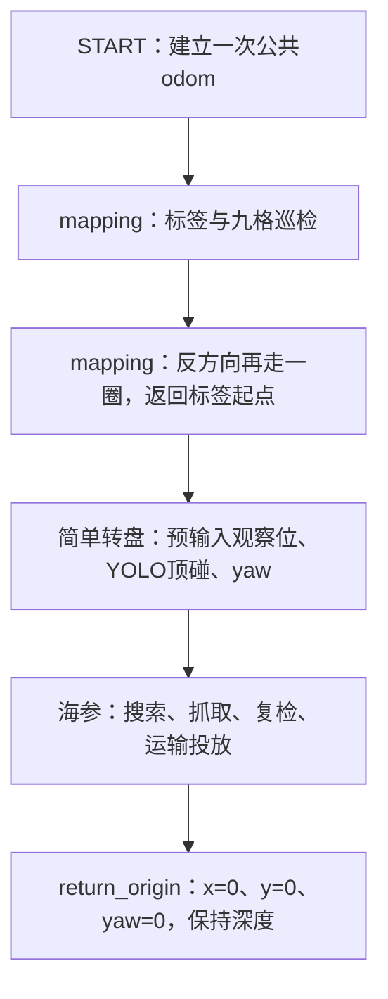

# 全流程联调任务树

配置：`src/uv_task/config/missions/full_flow_debug.yaml`。



任一任务失败或停止就终止后续执行；最后返回是正常完成后的步骤，不是失败后的自动返航。
只有一个START；所有阶段的坐标必须相对同一个发车原点填写。
如果海参任务修改了odom平移，返回也使用修正后的任务odom；依赖校正正确，不能保证消除全部物理定位误差。

## conclusion 开关

本任务链的mapping参数已显式覆盖：

```yaml
enable_traversal: true
enable_conclusion: true       # false关闭结论接口，地图仍发布
require_complete_survey: true
```

修改本任务链的 `enable_conclusion` 后重启task_runner。
任务链覆盖值优先，单独修改 `tasks/mapping_grid.json` 不会改变本链已覆盖的开关。
开启后 `/task/mapping/conclusion` 以fallback配置输出；关闭时地图内嵌结论为null。
视觉分类不足仍允许fallback与反向遍历；相机/位姿不可用导致首圈无法执行时，本链失败，不跳过mapping进入转盘。

## 连调参数位置

- mapping：`tasks/mapping_grid.json` 中九宫格/标签坐标、深度、fallback格点及标签ID。
- 简单转盘：`tasks/turntable_simple.yaml` 的 `disk_pose_odom` 填写盘心 `[x,y,z,yaw度]`；当前仍为 `[]`，留空会从mapping终点直接找框。预定位总预算180秒。
- 海参：`tasks/grab_sea_cucumber.yaml` 的搜索位、投放位、框心坐标、相机/爪子几何和下压参数。
- 返回：链中 `return_origin.timeout=150秒`；只返回水平原点和START航向，保留当时深度。

当前任务使用的类别约定为mapping锥桶0/1、转盘3、海参2、收集框4。
共享 `robotcup20260901.yaml` 对这些ID的标签不同，实际加载权重必须核对；
本任务树不自动切换YOLO模型，不能仅凭任务名认定识别类别正确。

## 启动

camera、basic_motion和录制已启动后，在仓库根目录执行：

```bash
source /opt/ros/humble/setup.bash
source workspace_auv/install/setup.bash
ros2 launch uv_task task_launch.py target_id:=mapping_grid \
  mission_file:="$PWD/workspace_auv/src/uv_task/config/missions/full_flow_debug.yaml"
```

查看结论：`ros2 topic echo /task/mapping/conclusion --qos-durability transient_local`。
START跳过准备倒计时，启动任务链后立即执行START；修改配置后重启任务节点生效。
